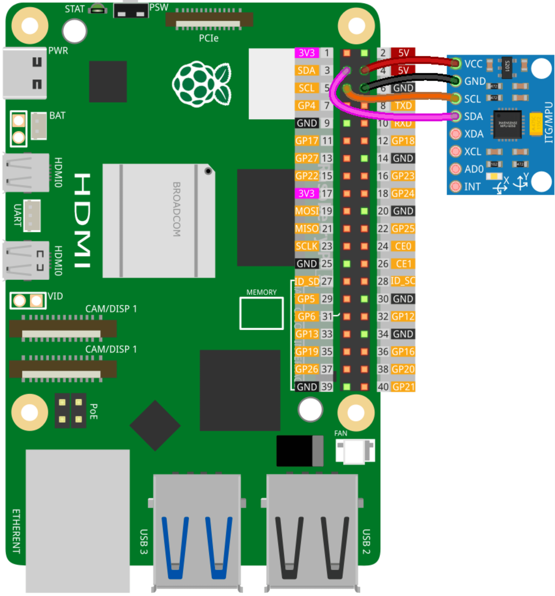

# mpu6050_driver

ROS 2 **Jazzy** driver for the **MPU6050** IMU (GY-521 breakout) connected to a
**Raspberry Pi** over I2C. It publishes `sensor_msgs/Imu` that is ready to be fused
with wheel odometry in `robot_localization`.

---

## 1. Wiring

<!-- Wiring image: save it as docs/wiring.png -->


| MPU6050 (GY-521) | Raspberry Pi pin |
|---|---|
| VCC | Pin 4 (5 V) |
| GND | Pin 6 (GND) |
| SDA | Pin 3 (GPIO 2, SDA) |
| SCL | Pin 5 (GPIO 3, SCL) |
| AD0 | Not connected or GND → address **0x68** (to 3.3 V → 0x69) |

The GY-521 board has its own 3.3 V regulator, so it can be powered from 5 V.

Mount the board **rigidly**, **near the robot's center** and **away from the motors**.
A piece of double-sided foam tape helps absorb vibration.

## 2. Prepare the Raspberry Pi (once)

Ubuntu 24.04 Server or Desktop with ROS 2 Jazzy installed.

```bash
# I2C tools and the development library (gives i2c/smbus.h)
sudo apt update
sudo apt install -y i2c-tools libi2c-dev

# Allow your user to use the I2C bus without sudo
sudo usermod -aG i2c $USER
# Log out and back in (or reboot) for the group change to apply
```

Check that I2C is enabled and that the sensor answers:

```bash
ls /dev/i2c-*        # should list /dev/i2c-1
i2cdetect -y 1       # should show 68 in the table
```

If `/dev/i2c-1` does not exist, add this line to `/boot/firmware/config.txt` and reboot:

```
dtparam=i2c_arm=on
```

If `i2cdetect` shows nothing, check the wiring before going further.

## 3. Build

Clone the repository into your workspace and build it:

```bash
cd ~/ros2_ws/src
git clone https://github.com/sahiedu/mpu6050_driver.git
cd ~/ros2_ws
rosdep install --from-paths src --ignore-src -y   # installs any missing dependency
colcon build --packages-select mpu6050_driver
source install/setup.bash
```

## 4. Run

```bash
ros2 launch mpu6050_driver mpu6050.launch.py
```

On startup the node **measures the gyro bias for 2 seconds. Keep the robot still.**

```
[mpu6050]: Found MPU-6050 (WHO_AM_I = 0x68)
[mpu6050]: Configured: gyro range 0, accel range 0, DLPF 3, clock source 1, 100 Hz
[mpu6050]: Calibrating gyro bias for 2.0 s: keep the robot completely still...
[mpu6050]: Gyro calibration done: bias = [-0.02516, 0.01041, 0.01080] rad/s, noise = 0.00092 rad/s
```

Nothing is published on `imu/data_raw` until this calibration finishes. If the robot
moves, the node retries (5 attempts by default), then falls back to the `gyro_bias` parameter.

Check the data in another terminal:

```bash
ros2 topic hz /imu/data_raw          # about 100 Hz
ros2 topic echo /imu/data_raw --once
```

With the sensor flat and still you should see:

* `angular_velocity` x, y, z close to **0** (within ±0.01 rad/s)
* `linear_acceleration.z` close to **+9.8**, with x and y close to 0
* `orientation_covariance[0]` = **-1** (the MPU6050 does not give orientation; that is normal)

Quick sign test: rotate the robot **counter-clockwise** (seen from above).
`angular_velocity.z` must be **positive**. If it is negative, the board is mounted
upside down. Describe that rotation in the static TF (section 7).

## 5. Calibrate the biases (recommended once)

The gyro bias is measured automatically at every startup. This tool also measures the
**accelerometer** bias and the sensor noise, and gives a fallback `gyro_bias`.

1. Power the robot for **2 to 3 minutes** so the sensor reaches its working temperature.
2. Place the sensor **flat (Z up)** and do not touch it.
3. Stop the node if it is running (two programs must not use the sensor at the same time).
4. Run:

```bash
ros2 run mpu6050_driver mpu6050_calibrate
```

5. Copy the printed lines into `config/mpu6050.yaml`, under `ros__parameters`:

```yaml
    gyro_bias: [-0.025156, 0.010409, 0.010797]    # rad/s
    accel_bias: [0.1230, -0.0415, 0.3102]    # m/s^2, gravity kept
    angular_velocity_stddev: 0.0100       # rad/s
    linear_acceleration_stddev: 0.1000    # m/s^2
```

6. Rebuild (`colcon build --packages-select mpu6050_driver`) so the installed copy of
   the YAML is updated. Or pass your own file:
   `ros2 launch mpu6050_driver mpu6050.launch.py params_file:=/path/to/my.yaml`

If you changed `gyro_range`, `accel_range` or `dlpf`, pass the same values to the tool:
`mpu6050_calibrate --gyro-range 1 --dlpf 4`. See `--help` for all options.

## 6. Topics, services and parameters

| Name | Type | Description |
|---|---|---|
| `/imu/data_raw` | `sensor_msgs/Imu` | Angular velocity [rad/s] and acceleration [m/s², gravity included]. Orientation is marked as not available. |
| `/imu/temperature` | `sensor_msgs/Temperature` | Chip temperature [°C], about 1 Hz |
| `/mpu6050/calibrate_gyro` | `std_srvs/Trigger` | Re-measure the gyro bias (robot still). Data keeps flowing with the old bias meanwhile. |

```bash
ros2 service call /mpu6050/calibrate_gyro std_srvs/srv/Trigger
```

Parameters are in `config/mpu6050.yaml`:

| Parameter | Default | Meaning |
|---|---|---|
| `i2c_bus` | `/dev/i2c-1` | I2C device |
| `i2c_address` | `104` (0x68) | `105` (0x69) if AD0 is high |
| `frame_id` | `imu_link` | Frame of the messages |
| `publish_rate` | `100.0` | Hz |
| `gyro_range` | `0` | 0 = ±250 °/s (best for ground robots) … 3 = ±2000 °/s |
| `accel_range` | `0` | 0 = ±2 g … 3 = ±16 g |
| `dlpf` | `3` | Low-pass filter: 0 = 260 Hz (noisy) … 3 = 44 Hz … 6 = 5 Hz |
| `clock_source` | `1` | 1 = gyro PLL (recommended by the datasheet), 0 = internal oscillator |
| `calibrate_gyro_on_startup` | `true` | Measure the gyro bias at startup |
| `calibration_duration` | `2.0` | Seconds of averaging |
| `calibration_max_gyro_stddev` | `0.02` | rad/s; above this, the robot counts as moving |
| `calibration_max_attempts` | `5` | Retries before using `gyro_bias` |
| `gyro_bias` | `[0, 0, 0]` | rad/s, fallback bias |
| `accel_bias` | `[0, 0, 0]` | m/s², subtracted from the acceleration |
| `angular_velocity_stddev` | `0.01` | rad/s, goes into the covariance (must be > 0) |
| `linear_acceleration_stddev` | `0.1` | m/s², goes into the covariance (must be > 0) |
| `publish_temperature` | `true` | Publish `/imu/temperature` |
| `max_consecutive_errors` | `10` | Failed reads in a row before re-initializing the sensor |

Invalid values stop the node with a message such as
`Parameter 'dlpf' = 9 is out of range [0, 6]`.

## 7. Axes and the TF tree

Data are expressed in the **sensor's own axes**: the X and Y arrows printed on the
board, with Z pointing up out of the chip. ROS needs to know where the sensor is on
the robot, which is the transform `base_link → imu_link`.

**If the X arrow points forward and the chip faces up**, only the position matters.
Example: 5 cm forward of the robot center, 10 cm above it:

```bash
ros2 launch mpu6050_driver mpu6050.launch.py publish_tf:=true x:=0.05 z:=0.10
```

**If the board is rotated**, add the rotation in radians. For example, X pointing to
the robot's left is `yaw:=1.5708`, and upside down is `roll:=3.1416`.

If your robot already has a URDF published by `robot_state_publisher`, add an
`imu_link` joint there instead and keep `publish_tf:=false`.

## 8. Using it with wheel odometry (robot_localization)

```bash
sudo apt install ros-jazzy-robot-localization
```

For a differential-drive robot, fuse the **yaw rate** from the IMU together with the
wheel odometry. Don't fuse the MPU6050's accelerations: they are too noisy to
integrate into position. Example `ekf.yaml`:

```yaml
ekf_filter_node:
  ros__parameters:
    frequency: 30.0
    two_d_mode: true
    publish_tf: true              # the EKF publishes odom -> base_link
    odom_frame: odom
    base_link_frame: base_link
    world_frame: odom

    odom0: /odom                  # your wheel odometry node (with its own TF disabled)
    odom0_config: [false, false, false,   # x, y, z
                   false, false, false,   # roll, pitch, yaw
                   true,  true,  false,   # vx, vy (0 for diff drive), vz
                   false, false, true,    # vroll, vpitch, vyaw
                   false, false, false]   # ax, ay, az

    imu0: /imu/data_raw
    imu0_config: [false, false, false,
                  false, false, false,
                  false, false, false,
                  false, false, true,     # only the yaw rate
                  false, false, false]
```

```bash
ros2 run robot_localization ekf_node --ros-args --params-file ekf.yaml
```

The EKF weights each source by its covariance. That's why `angular_velocity_stddev`
must be realistic and never 0.

## 9. Troubleshooting

| Message / symptom | Cause and fix |
|---|---|
| `fatal error: i2c/smbus.h: No such file` or `libi2c not found` | `sudo apt install libi2c-dev` |
| `Cannot open /dev/i2c-1: No such file or directory` | I2C is disabled: add `dtparam=i2c_arm=on` to `/boot/firmware/config.txt`, then reboot |
| `Cannot open /dev/i2c-1: Permission denied` | `sudo usermod -aG i2c $USER`, then log out and back in |
| `Remote I/O error` / `The sensor is not answering` | Wiring or address: run `i2cdetect -y 1` |
| `WHO_AM_I = 0x70 (MPU-6500…), not a genuine MPU-6050` | Clone chip. It usually works; check the data. The temperature reading may be off. |
| `Robot moved during calibration` | Keep the robot still at startup, or raise `calibration_max_gyro_stddev` if the motors vibrate while idle |
| `Sensor saturated` | Readings at the end of the range: use `gyro_range: 1` |
| `Read failed (...)` repeating | Loose cable or electrical noise from the motors: shorter wires, twisted SDA/SCL with GND |
| Heading still drifts slowly | Normal for an MPU6050. Recalibrate after warm-up with the service. |
| `angular_velocity.z` negative when turning left | Board upside down: add `roll:=3.1416` to the TF |

## Package layout

```
mpu6050_driver/
├── config/mpu6050.yaml          parameters (edit this)
├── launch/mpu6050.launch.py     driver + optional static TF
├── include/mpu6050_driver/
│   ├── i2c_bus.hpp              Linux I2C access (abstract, so it can be simulated)
│   ├── mpu6050.hpp              sensor driver, no ROS dependency
│   ├── running_stats.hpp        mean / standard deviation for calibration
│   └── mpu6050_node.hpp         ROS 2 node
└── src/
    ├── i2c_bus.cpp, mpu6050.cpp, mpu6050_node.cpp, mpu6050_node_main.cpp
    └── calibrate_main.cpp       mpu6050_calibrate tool
```

## License

BSD-3-Clause. Based on the design of
[kimsniper/ros2_mpu6050](https://github.com/kimsniper/ros2_mpu6050)
(BSD-3-Clause, Copyright (c) 2022, Mezael Docoy).
